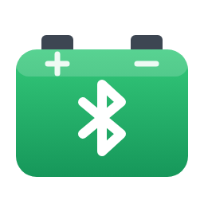

# Leagend Battery Monitor (BM2 / BM6) for Home Assistant

A Home Assistant custom integration that reads **Leagend BM2 and BM6**
Bluetooth car battery monitors (also sold under other brand names) through
Home Assistant's own Bluetooth stack - a local adapter or any **ESPHome
Bluetooth proxy**. No cloud, no app, no extra hardware or firmware per car.

> **Please read:** this integration was generated by
> [Claude](https://claude.ai) (Anthropic's AI assistant) for my personal use.
> I'm happy to share it in case it's useful to someone else, but it's
> provided as-is and **no support will be provided**. Issues and pull
> requests may not be answered. Use at your own risk.

## What you get

| Entity | BM2 | BM6 |
|---|:---:|:---:|
| Battery voltage | ✓ | ✓ |
| Battery state of charge (%) | | ✓ |
| Battery temperature | | ✓ |
| Battery status (Normal / Charging / Low charge) | | ✓ |
| In range (on while the monitor answered in the last 16 minutes) | ✓ | ✓ |

Readings keep their last value while the car is away, and across Home
Assistant restarts. The *In range*
sensor works well as a "car is home" sensor, and its attributes show when
the monitor was last read and heard, and the last error (handy when
troubleshooting).

## How it works

- Every 5 minutes the integration connects to the monitor, takes one
  reading and disconnects (the BM6 is asked for a reading; the BM2 sends
  one as soon as it's connected).
- When the monitor is heard advertising after a gap (e.g. the car comes
  home), it reads straight away instead of waiting for the next poll.
- Home Assistant picks whichever connectable adapter or proxy hears the
  monitor best, so you can add proxies near where the cars park without
  any car-specific configuration.
- The monitors encrypt their data (AES-128-CBC, fixed per-model key, as
  documented by several open-source projects); the integration handles it.

## Requirements

- Home Assistant 2025.1 or later with the **Bluetooth** integration set up.
- A **connectable** Bluetooth adapter or proxy within range of the car -
  e.g. an [ESPHome Bluetooth proxy](https://esphome.io/components/bluetooth_proxy.html)
  with `active: true`. Passive-only scanners (such as Shelly devices'
  Bluetooth) can hear the monitor but can't connect to it.
- The monitor sits under the bonnet, surrounded by metal, so its signal is
  weak. A proxy within a few metres of where the car parks (an ESP32 with
  an external antenna works well) helps a lot.

## Installation

**HACS (custom repository):** HACS → ⋮ → *Custom repositories* → add
`https://github.com/scottbambrick/ha-leagend-battery-monitor` as an
*Integration* → install → restart Home Assistant.

**Manual:** copy `custom_components/leagend_ble` into your Home Assistant
`config/custom_components/` folder and restart.

## Setup

*Settings → Devices & services → Add integration → Leagend Battery
Monitor*, then enter:

- **Name** - e.g. "Car Battery Monitor" (entities are named after it)
- **Bluetooth address** - the monitor's MAC address, e.g.
  `AA:BB:CC:DD:EE:FF`. It's shown in the monitor's phone app, or look for
  a device advertising as `BM2` / `BM6` in Home Assistant's Bluetooth
  advertisement monitor (*Settings → Devices & services → Bluetooth →
  Advertisement monitor*).
- **Model** - `bm2` or `bm6`.

Add one entry per monitor.

## Notes

- Close the monitor's phone app while testing: the monitor only accepts
  one connection at a time.
- To see what it's doing, enable debug logging:
  ```yaml
  logger:
    logs:
      custom_components.leagend_ble: debug
  ```

## Licence

[MIT](LICENSE).

## Development

The protocol code is covered by unit tests that run without Home Assistant:

```sh
pip install pytest cryptography
pytest
```

GitHub Actions runs them, `ruff`, `hassfest` and the HACS validation on
every push.
